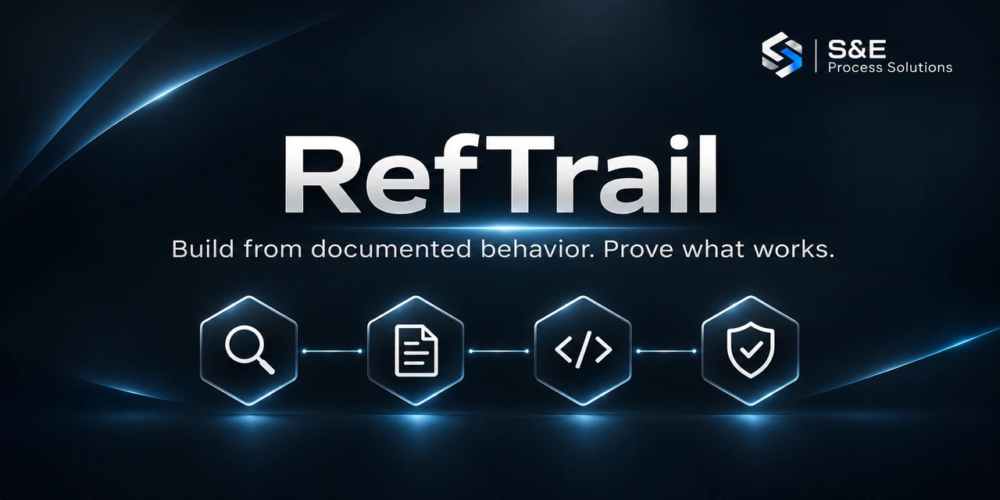

[🇬🇧 English Version](README.md)

# RefTrail

Entwickle eine eigenständige Anwendung anhand belegten Verhaltens. Lege die Abnahmekriterien vor dem Programmieren fest und zeige anschließend, welche Arbeitsabläufe funktionieren und wo die Belege enden.

Ein Coding-Agent meldet eine Funktion nach wenigen Minuten als fertig. RefTrail macht diese Meldung überprüfbar. Jede Anforderung erhält eine Quelle und ein messbares Ergebnis, die Kriterien werden vor der ersten Zeile Produktcode festgeschrieben, und der Abschlussbericht nennt, was belegt ist, durch welche Prüfung und was noch offen ist.

| Baustein | Aufgabe |
| --- | --- |
| [Arbeitsauftrag](prompts/referenzentwicklung.md) | Gibt einem Coding-Agenten vor, wie er ein Referenzprodukt recherchiert, die Kriterien festlegt, einen abgegrenzten Ablauf umsetzt und das Ergebnis berichtet. |
| [Abdeckungskatalog](templates/ABDECKUNG.csv) | Eine Zeile je Anforderung mit Quelle, Gewicht, Abnahmekriterium, Stand, Nachweis und dessen Grenze. |
| [Kriterienwerkzeug](tools/README.md#abnahmekriterien-festschreiben) | Schreibt die Kriterien als bytegleiche Kopie mit SHA-256-Prüfsumme fest und erkennt jede spätere Änderung. |
| [Katalogwerkzeug](tools/README.md#katalog-prüfen-und-auswerten) | Prüft den Katalog und berechnet die gewichtete Abdeckung zusammen mit den Pflichtprüfungen. |
| [Durchgespieltes Beispiel](showcase/uniq/README.md#auf-deutsch) | Ein kleiner Nachbau mit allen Unterlagen, einschließlich einer Kriterienrevision und einer korrigierten Prüfung. |

Die Werkzeuge brauchen Node.js ab 22.16 und keine weiteren Pakete.

## Einen fertigen Nachbau ausprobieren

[Line Runs](showcase/uniq/README.md#auf-deutsch) bildet vier Aufrufvarianten von GNU `uniq` für Standardeingabe und -ausgabe nach. Stehen die Wörter `bolt, bolt, nut, bolt` auf vier aufeinanderfolgenden Zeilen, meldet der Zählmodus drei Gruppen der Größe **2, 1 und 1**. Prüfe das Beispiel vom Repository-Stamm aus:

```sh
node showcase/uniq/verify.mjs
node tools/catalog.mjs report showcase/uniq/COVERAGE.csv --gates G01
```

Der erste Befehl spielt die Abnahmefälle gegen die festgeschriebenen Sollwerte durch. Der zweite berechnet das Ergebnis aus dem englischsprachigen Katalog des Beispiels: `100% functional coverage, 1/1 mandatory checks passed`. Für einen direkten Vergleich auf deinem Rechner installiere GNU Coreutils separat und ergänze beim ersten Befehl `--reference`.

Alle dokumentierten Ausgabevergleiche lieferten bytegleich dieselbe Ausgabe wie GNU `uniq`: **16 von 16** unter Linux mit Version 9.4 für die erste Kriterienrevision, für Revision 2 **16 von 16** unter Windows mit Version 8.32 und **16 von 16** unter Linux mit Version 9.4. Revision 2 ergänzt ein stilles Ende, wenn ein nachfolgendes Programm die Ausgabe vorzeitig schließt, und wurde vor der Programmänderung festgeschrieben. **2 von 2 Abbruchprüfungen** bestanden für beide Programme auf beiden Systemen. Sie prüfen Beendigung und Fehlerausgabe, keine Ausgabebytes. **Vier lokale Prüfungen** für unzulässige Aufrufe bestanden. Ein getrennter Prüfer verglich 40 weitere Eingaben in allen vier Modi. Der Fall enthält die [vorab festgelegten Kriterien](showcase/uniq/criteria.json), das [Programm](showcase/uniq/line-runs.mjs), den [ausgefüllten Katalog](showcase/uniq/COVERAGE.csv), den [Prüfbericht mit Zeit und Kostenstatus](showcase/uniq/TEST_REPORT.md) und den [Abschlussstand](showcase/uniq/STATUS.md).

## Im eigenen Projekt verwenden

1. Öffne den [deutschen Arbeitsauftrag](prompts/referenzentwicklung.md). Trage Referenzprodukt und offizielle Homepage ein. Wenn bekannt, ergänze Edition, gewünschte Arbeitsabläufe und Budget.
2. Gib den Auftrag im Zielverzeichnis an deinen Coding-Agenten. Bei nur zwei Angaben umfasst der erste Lauf einen abgegrenzten End-to-End-Ablauf auf einer Plattform und höchstens 60 Minuten. Ein größeres Produktziel bleibt in der Liste offener Arbeiten sichtbar.
3. Halte für jede Anforderung Quelle und prüfbares Ergebnis fest. Friere die Kriterien vor dem ersten Implementierungsschritt ein und bewahre den Hash separat auf. Fortschritt und Nachweise stehen im [Abdeckungskatalog](templates/ABDECKUNG.csv). Für diese Schritte ruft der Auftrag die [Werkzeuge](tools/README.md#deutsch) auf. Lege deshalb eine heruntergeladene Kopie dieses Repositorys dort ab, wo dein Agent sie lesen kann, oder kopiere den Ordner `tools` in dein Projekt.
4. Prüfe das Ergebnis über den echten Benutzerzugang. Berichte die gewichtete Funktionsabdeckung **zusammen mit** den bestandenen Pflichtprüfungen, offenen kritischen Fehlern und der Abnahmeentscheidung. Das Katalogwerkzeug gibt die ersten beiden gemeinsam aus. Eine fehlende Pflichtsicherung kann auch bei 100 % gewichteter Abdeckung die Freigabe blockieren.

## Was RefTrail dir überlässt

- **Den Zugang zur Referenz.** RefTrail ordnet, was du beobachten darfst. Es untersucht und öffnet kein Produkt.
- **Den Beleg der Reihenfolge.** Die Prüfsumme zeigt, dass die Kriterien unverändert sind. Dass sie vor dem Code vorlagen, ergibt sich aus dem Ort, an dem du die Prüfsumme aufbewahrt hast. Wähle einen Ort, den der Umsetzer nicht umschreiben kann, etwa einen hochgeladenen Commit oder eine Nachricht an den Auftraggeber.
- **Die Reichweite eines Ergebnisses.** Ein bestandener Katalog gilt für die aufgeführten Fälle auf den geprüften Systemen. Gleichwertigkeit mit dem gesamten Referenzprodukt verlangt weitere Fälle.
- **Die rechtliche Prüfung.** Die Hinweise unten sind allgemeine Informationen.

## Zusammenspiel mit REA

REA kann einem Agenten helfen, eine konkrete Frage zu einer zugänglichen Anwendung, einem Paket oder einer ausführbaren Datei zu untersuchen. Ein autorisiert erhobener, reproduzierbarer Befund lässt sich in RefTrail als Beobachtung erfassen. Halte Version, Vorgehen, Beleg und Prüfgrenze fest und prüfe anschließend die eigene Umsetzung daran. Gib das beobachtete Verhalten in eigenen Worten weiter und halte dekompilierten Code von dem Agenten fern, der die Umsetzung schreibt. Das mitgelieferte Beispiel verwendet direkt die Kommandozeile von GNU. [REA-Projekt](https://github.com/morluto/rea)

## Optionale Lieferprüfungen

Den Methodenkern bilden Arbeitsauftrag, Katalog und festgeschriebene Kriterien. Die [technischen Beispiele](examples/windows/USAGE.md) helfen, wenn ein bestimmter geprüfter Quellstand ausgeliefert werden soll. Der [Integrationslauf](integration/README.md) sichert den geprüften Stand, wiederholt darin die Tests, prüft daraus den Nachbau und verpackt das Programm mit seiner Lizenz. Für ein installierbares Windows-Produkt gibt es die [Abnahmeanleitung für das Zielsystem](docs/produktabnahme.md).

```sh
node --test "tests/*.test.mjs"
node integration/verify.mjs
```

Die direkte Testsuite verwendet den Temp-Ordner der aufrufenden Umgebung. Der Paketierlauf setzt für seine Quelltests einen eigenen Temp-Ordner. Der GitHub-Workflow sieht beide Prüfungen und einen zusätzlichen Windows-Test mit einem Pfadalias vor. `npm test` startet ebenfalls die direkte Testsuite.

## Referenzmaterial und Lizenz

Verwende Quellen und Zugänge, für die du eine Berechtigung hast. Prüfe die Bedingungen für jede Quelle und Datei, die du übernehmen willst. Ein Lizenz- oder Testvertrag kann Nutzungen einschränken, die das Urheberrecht allein zuließe. Beschreibe das benötigte Verhalten in eigenen Worten. Entwirf Oberfläche, Texte, Symbole und Grafiken selbst. Gib dem Ergebnis einen eigenen Namen.

In der EU sind die Funktionalität eines Programms, seine Programmiersprache und seine Dateiformate nicht durch das Urheberrecht an Computerprogrammen geschützt. Ein berechtigter Nutzer darf das Funktionieren eines Programms beobachten, untersuchen und testen, während er es im Rahmen der Lizenz verwendet. Die Übernahme von Handbuchtext kann dennoch Rechte verletzen. [EuGH, C-406/10](https://eur-lex.europa.eu/legal-content/DE/TXT/?uri=CELEX:62010CJ0406) Eine eigenständig schöpferische grafische Oberfläche kann urheberrechtlich geschützt sein. [EuGH, C-393/09, Randnummern 44–51](https://eur-lex.europa.eu/legal-content/DE/TXT/?uri=CELEX:62009CJ0393) Das Dekompilieren eines Programms ist nur in engen Fällen wie der Herstellung von Interoperabilität erlaubt, und seine Ergebnisse dürfen nicht dazu dienen, ein Programm mit im Wesentlichen ähnlicher Ausdrucksform zu entwickeln. [Richtlinie 2009/24/EG, Artikel 6](https://eur-lex.europa.eu/legal-content/DE/TXT/?uri=CELEX:32009L0024) Dokumentiere die Grundlage für notwendige Schnittstellenkennungen und gesondert lizenzierte Inhalte. Marken-, Wettbewerbs-, Geheimnisschutz- und Vertragsrecht gelten daneben. Diese Hinweise sind allgemeine Informationen und keine Rechtsberatung. Lass ein konkretes Vorhaben prüfen, bevor du es veröffentlichst oder verkaufst.

Die eigenen Arbeitsaufträge, Vorlagen, Beispielprogramme und Anleitungen von RefTrail stehen unter der [MIT-Lizenz](LICENSE). Für die Referenzprodukte gelten ihre jeweiligen Bedingungen. [Änderungen](CHANGELOG.md) · [Mitwirken](CONTRIBUTING.md)
