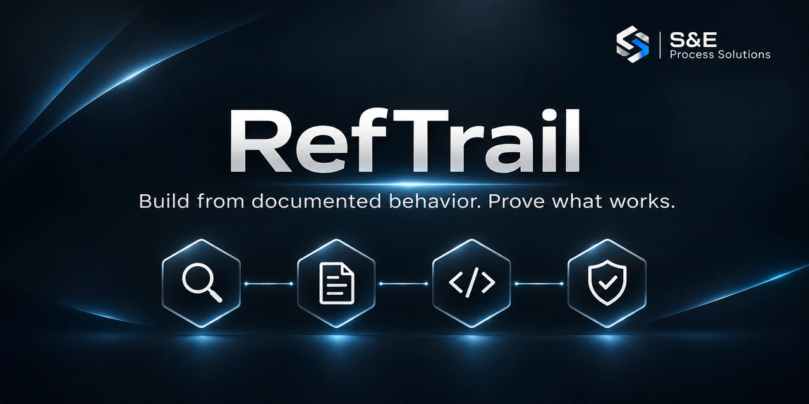

[🇩🇪 Deutsche Version](README.de.md)

# RefTrail

Build an independent implementation from documented behavior. Set the acceptance criteria before coding, then show which workflows pass and where the evidence ends.

A coding agent reports a finished feature within minutes. RefTrail makes that report checkable. Each requirement gets a source and a measurable outcome, the criteria are frozen before the first line of product code, and the final report states what was proven, by which check, and what is still open.

| Part | What it does |
| --- | --- |
| [Agent brief](prompts/reference-development.md) | Tells a coding agent how to research a reference product, fix the criteria, build one bounded workflow and report the result. |
| [Coverage catalog](templates/COVERAGE.csv) | One row per requirement with source, weight, acceptance criterion, status, evidence and the limits of that evidence. |
| [Criteria tool](tools/README.md#freeze-acceptance-criteria) | Freezes the criteria as an exact copy with a SHA-256 digest and detects every later change. |
| [Catalog tool](tools/README.md#check-and-report-the-coverage-catalog) | Checks the catalog and calculates weighted coverage next to the mandatory checks. |
| [Worked example](showcase/uniq/README.md) | A small rebuild with all of its records, including a criteria revision and a corrected test. |

The tools need Node.js 22.16 or newer and no further packages.

## Try a finished rebuild

[Line Runs](showcase/uniq/README.md) reproduces four stdin/stdout modes of GNU `uniq`. Given `bolt, bolt, nut, bolt` as four consecutive lines, its count mode returns three groups of **2, 1 and 1**. Run the acceptance cases from the repository root:

```sh
node showcase/uniq/verify.mjs
node tools/catalog.mjs report showcase/uniq/COVERAGE.csv --gates G01
```

The first command replays the acceptance cases against the frozen expectations. The second calculates the result from the catalog: `100% functional coverage, 1/1 mandatory checks passed`. To compare both programs on your machine, install GNU Coreutils separately and append `--reference` to the first command.

Every recorded output comparison matched GNU `uniq` byte for byte: **16 of 16** under Linux with version 9.4 for the first criteria revision, and for revision 2 **16 of 16** under Windows with version 8.32 and **16 of 16** under Linux with version 9.4. Revision 2 adds a quiet stop when a reader closes the output early. It was frozen before the program changed, and **2 of 2 early-exit checks** passed for both programs on both systems. These checks cover termination and stderr, not output bytes. All **four local invalid-input checks** passed. An additional reviewer tested 40 more inputs across all four modes. Inspect the [criteria fixed before coding](showcase/uniq/criteria.json), [working program](showcase/uniq/line-runs.mjs), [filled catalog](showcase/uniq/COVERAGE.csv), [report with timings and cost status](showcase/uniq/TEST_REPORT.md) and [delivery decision](showcase/uniq/STATUS.md).

## Use it on your own project

1. Open the [English agent brief](prompts/reference-development.md). Supply a product and its official website. Add the desired edition, workflows, limits and budget if you know them.
2. Give the completed brief to your coding agent in the target directory. With only the two inputs, the first run covers one bounded end-to-end workflow on one platform, with a 60-minute limit. A larger product goal stays visible in the backlog.
3. Record each requirement, source and measurable outcome. Freeze the criteria before implementation and retain the digest independently. Keep progress and evidence in the [coverage catalog](templates/COVERAGE.csv). The brief runs the [tools](tools/README.md) for these steps, so keep a downloaded copy of this repository where your agent can read it, or copy the `tools` folder into your project.
4. Run the finished workflow through its real interface. Report weighted feature coverage **alongside** passed mandatory checks, unresolved critical defects and the delivery decision. The catalog tool prints the first two together. A missing mandatory backup can block acceptance even at 100% weighted coverage.

## What RefTrail leaves to you

- **Access to the reference.** RefTrail organizes what you are allowed to observe. It does not analyze or open a product.
- **Proof of the sequence.** The digest shows that the criteria did not change. That they existed before the code follows from where you kept the digest. Use a place the implementer cannot rewrite, such as a pushed commit or a message to the requester.
- **The reach of a result.** A passed catalog covers the listed cases on the tested systems. Equivalence with the whole reference product needs more cases.
- **The legal review.** The notes below are general information.

## Working with REA

REA can help an agent investigate a specific question about an accessible application, package or executable. RefTrail can use an authorized, reproducible REA finding as an observation: record the target version, procedure, evidence and limitations. Then test the independent implementation against that observation. Pass on the observed behavior in your own words and keep decompiled code away from the agent that writes the implementation. The included example uses the GNU CLI directly. [REA project](https://github.com/morluto/rea)

## Optional release checks

The core method consists of the brief, the coverage catalog and the criteria baseline. The [technical examples](examples/windows/USAGE.en.md) apply when you want to bind tested sources to a deliverable. The [integration runner](integration/README.md) freezes the checked tree, reruns the tests and verifies the showcase from that copy and packages the candidate and its license. For an installable Windows product, use the [target-system acceptance guide](docs/product-acceptance.md).

```sh
node --test "tests/*.test.mjs"
node integration/verify.mjs
```

The direct suite uses the ambient temporary directory. The packaging runner runs its source tests with a separate temporary directory. The GitHub workflow exercises both and includes a Windows path-alias check. `npm test` runs the direct suite as well.

## Reference material and license

Use sources and accounts you are authorized to access. Check the terms for each source and file you plan to reuse. A license or trial agreement can restrict uses that copyright law alone would allow. Describe the required behavior in your own words and create your own screen layouts, text, icons and artwork. Give the result its own name.

In the EU, the functionality of a program, its programming language and its data file formats are not protected by the copyright in computer programs. A licensed user may observe, study and test how a program works while using it as the license allows. Copying text from a manual can still infringe. [CJEU, C-406/10](https://eur-lex.europa.eu/legal-content/EN/TXT/?uri=CELEX:62010CJ0406) An original GUI can qualify for copyright protection. [CJEU, C-393/09, paragraphs 44–51](https://eur-lex.europa.eu/legal-content/en/TXT/?uri=CELEX:62009CJ0393) Decompiling a program is permitted only in narrow cases such as interoperability, and its results must not serve to build a program that is substantially similar in its expression. [Directive 2009/24/EC, Article 6](https://eur-lex.europa.eu/legal-content/EN/TXT/?uri=CELEX:32009L0024) Record the basis for any necessary interface identifiers and separately licensed material. Trademark, unfair-competition, trade-secret and contract law apply separately. These notes are general information and no legal advice. Have a concrete project reviewed before you publish or sell it.

RefTrail's own briefs, templates, example code and documentation are available under the [MIT License](LICENSE). The reference products have their own terms. [Changes](CHANGELOG.md) · [Contributing](CONTRIBUTING.md)
